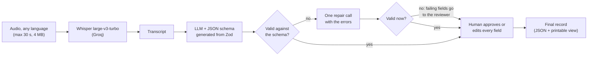

# talk-to-form

[](https://github.com/syedaayanahmed2001/talk-to-form/actions/workflows/ci.yml)

Workplace incident reports often have to be written in formal German or English by people who saw what
happened but don't write either language; talk-to-form lets them say it in their own language and gives a
reviewer a structured report to check field by field.

<!-- demo gif / live link goes here -->

You record up to 30 seconds in any language (Turkish, Arabic, Hindi, German, English and others). The
audio is transcribed, a language model fills in an incident report against a schema, and a person
approves or corrects each field, seeing the exact words each field came from, before the record is
final. The output is formal German or English, and you choose which.

## How it works



1. **Transcribe.** `POST /api/transcribe` sends the clip to Whisper on Groq and returns the transcript and
   detected language.
2. **Extract.** `POST /api/extract` asks `openai/gpt-oss-120b` on Groq for JSON that must follow a strict
   JSON schema. That schema is generated from the Zod schema in `lib/incident/schema.ts`.
3. **Validate and repair.** The answer is validated with the same Zod schema. If it fails, the model gets
   one more try with the exact validation errors. If that fails too, the fields that did validate are kept
   and the rest are marked for the reviewer. There is never a third call.
4. **Check sources.** Every field carries the transcript snippet it came from and a confidence hint. A
   snippet that isn't actually in the transcript is flagged and its confidence drops to low.
5. **Review.** The reviewer approves or edits each of the nine fields: what happened, date, time,
   location, people involved, injuries, immediate actions, witnesses and follow-ups. Edits are validated
   against the same schema. Only when all nine are approved does the final record appear, as JSON and as
   a printable page.

## Run it locally

You need Node.js 22.

```bash
git clone https://github.com/syedaayanahmed2001/talk-to-form.git
cd talk-to-form
npm ci
npm run dev            # http://localhost:3100
```

**Without an API key** the app runs in demo mode. The three samples (Turkish, Arabic, Hindi) replay
recorded model answers through the real pipeline, so validation, the repair step and the source check
all run. Recording or uploading returns a recorded example, and the page says so next to the result.

**With a key** it runs live. Get a free key at [console.groq.com](https://console.groq.com/keys), then:

```bash
cp .env.example .env.local
# put your key after GROQ_API_KEY= in .env.local
npm run dev
```

If Groq's free tier answers with a rate limit or a server error, the app falls back to a recorded example
and tells you, instead of failing.

Checks:

```bash
npm run typecheck
npm run lint
npm test               # Vitest: schema, pipeline, repair, rate limit, routes, review UI
npm run test:req       # the same tests, plus a table of which tests prove which requirement
npm run test:e2e       # production build + Playwright smoke test (npx playwright install chromium once)
```

## Deploy to Vercel

1. Import the repository in Vercel. No build settings are needed.
2. Add the environment variable `GROQ_API_KEY` (Project Settings → Environment Variables). Optional:
   `GROQ_CHAT_MODEL`, `GROQ_STT_MODEL`.
3. Deploy. Without the variable the deployment still works, in demo mode.

`GET /api/status` reports `live` or `demo` per request, so adding the key takes effect without a
rebuild.

## Design decisions

**Schema first.** The incident report is defined once, as a Zod schema. The JSON schema the model must
follow, the validation of its answer, the validation of human edits, and the list of fields in the UI are
all derived from it. A field can't exist in one place and be missing in another, and a test checks that.
Groq's strict mode needs closed objects with every property required, so optional values are expressed
as "value or null", and `null` means "not mentioned", never a guess.

**A human approves every field, one at a time.** A language model drafting an incident report will
sometimes be wrong, and an incident report is the kind of document where that matters. Each field shows
the words it came from, so checking it is quick: does this snippet say this? There is deliberately no
"approve all" button. Edits go through the same schema as model output.

**One repair, then hand over.** Invalid output gets exactly one repair attempt with the validation
errors. That bounds cost and latency on a free tier, and the fallback after that is the reviewer, not a
loop.

**Demo mode on recorded examples.** Free tiers get rate limited, CI has no key, and a visitor should be
able to try the whole flow anyway. Recorded answers are replayed through the real pipeline rather than
served as canned results, so the demo shows validation and repair working, and a test fails if a fixture
stops matching the schema. When the page shows a recorded example, it says so next to the result.

**Plain fetch, injected dependencies.** The Groq client is a few lines of `fetch` against the
OpenAI-compatible endpoints. Route logic lives in plain functions that take their dependencies (config,
rate limiter, provider) as arguments, so every branch is tested without a server, a key or the network.

**Abuse limits for a public demo.** 30 seconds and 4 MB per clip, checked in the browser and again on
the server before any provider call. 10 live requests per 10 minutes per IP and route. The API key is
read only on the server, and a build step fails if it or the provider host shows up in the browser
bundle.

## How this was built: spec first

Before any code, the requirements were written down with IDs (INC, EXT, API, DEMO, UI, QA) and testable
acceptance criteria. The project was then built in four phases (schema and extraction core, API and
provider, review UI, CI and docs), each one specified before it was implemented. Every test name carries
the IDs it proves, and CI fails if a requirement has no passing test.

Read the specification: [docs/SPEC.md](docs/SPEC.md).

## Project layout

```
lib/incident/      schema (single source of truth), UI field metadata, strict JSON schema
lib/extract/       prompt, pipeline (validate, repair, salvage), source check
lib/provider/      provider interface, Groq client, replay provider for recorded samples
lib/server/        route handlers, config, rate limiter, demo fallbacks
lib/demo/          the three recorded samples (fictional people and places)
lib/review.ts      review state: approve, edit, final-record gate
components/        the one-page UI
app/api/           thin route files wiring the handlers
tests/, e2e/       Vitest and Playwright, test names tagged with requirement IDs
docs/SPEC.md       requirements and acceptance criteria
```

## Limitations

- The rate limiter is in memory. On serverless platforms each instance counts on its own, so the real
  ceiling is higher than 10 per 10 minutes. A shared store (Redis or KV) would fix that.
- Nothing is stored. The record lives in the browser until you copy, download or print it.
- One form type: the workplace incident report. The schema module is built so a second form is a new
  schema and metadata file, but only one exists.
- Whisper's accuracy varies by language and accent, and the model resolves relative dates ("last
  Tuesday") against the day of the recording. The reviewer is the safeguard for both.
- The recorded samples were written for this project and their "recorded" answers were written to match;
  they show the pipeline, not model quality. Live quality depends on the Groq models.
- The UI itself is in English; field labels and the report follow the chosen output language.
- Audio is sent to Groq for processing when a key is configured. Check that this is acceptable before
  using real incident data.

## License

MIT © 2026 Syed Aayan Ahmed. See [LICENSE](LICENSE).
